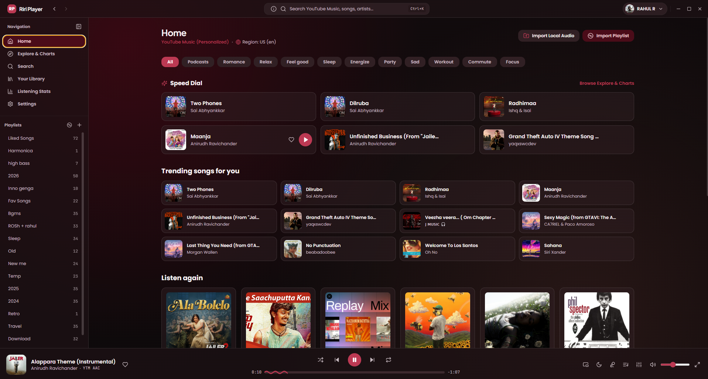
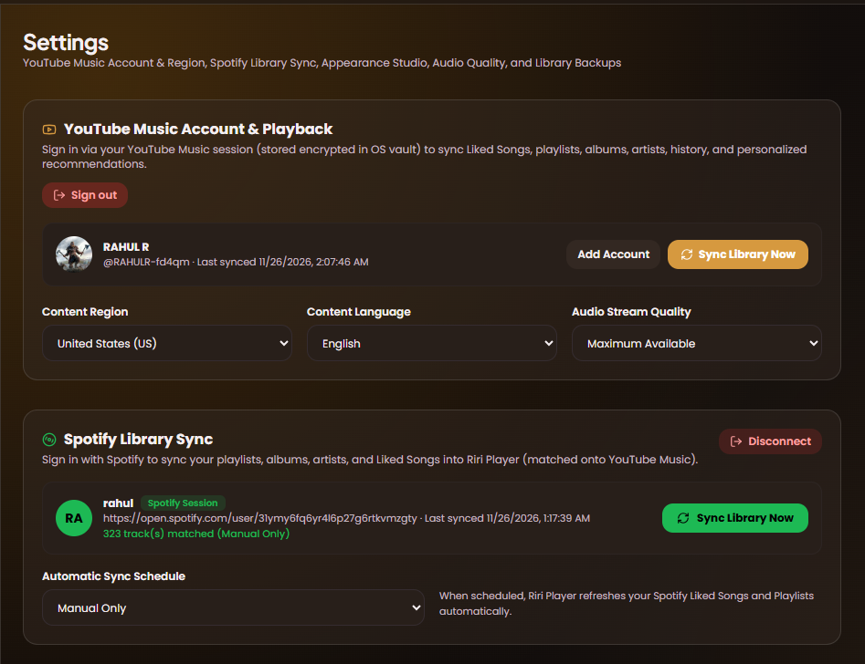
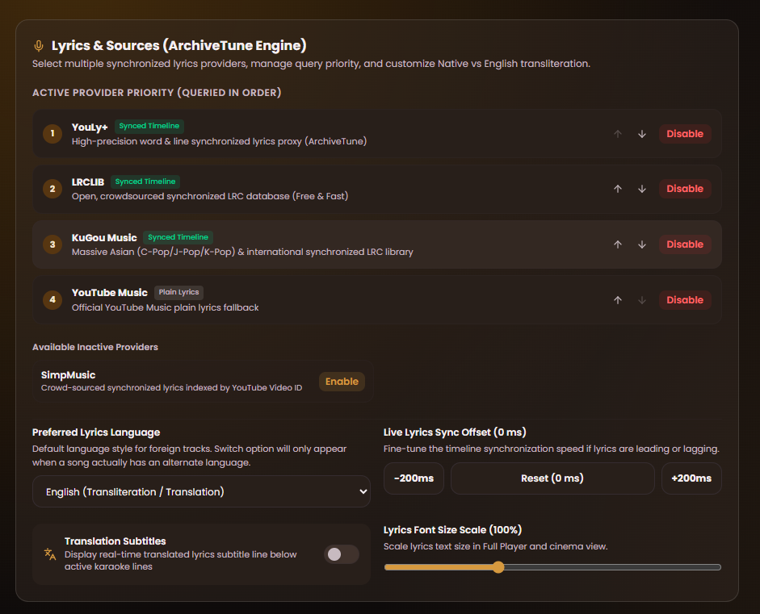
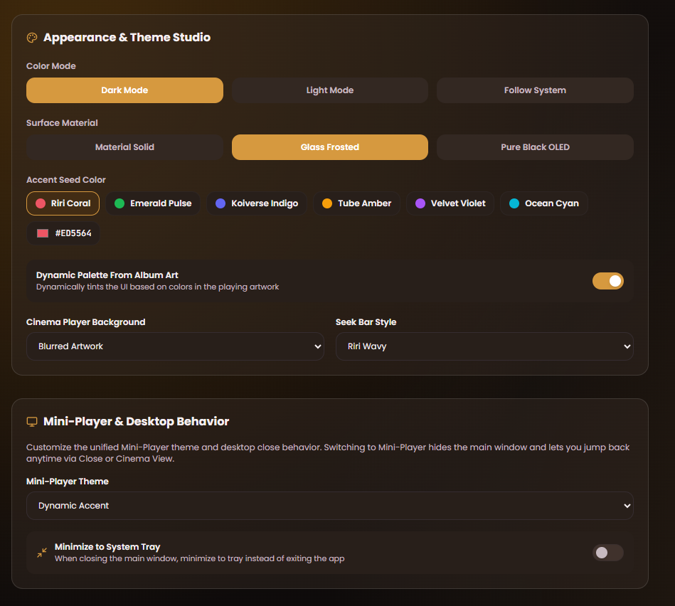

# Riri Player (Web / Desktop Edition)

**Riri Player** is a Material 3 Expressive YouTube Music and local audio desktop player built with React, TypeScript, Vite, Tailwind CSS, and Electron. Its session login, InnerTube client hierarchy, stream resolver, and Spotify library matcher are inspired by and ported in TypeScript from **[ArchiveTune](https://github.com/rukamori/ArchiveTune)** (licensed under GPL-3.0).

<p>
  
  
  
  
  
  
  
</p>

---

## Table of Contents

- [Screenshots](#screenshots)
- [Why Riri Player](#why-riri-player)
- [Feature Highlights](#feature-highlights)
- [Tech Stack](#tech-stack)
- [Getting Started](#getting-started)
- [Available Scripts](#available-scripts)
- [Building Windows Installers](#building-windows-installers)
- [Using the App](#using-the-app)
- [Settings Reference](#settings-reference)
- [How It Works](#how-it-works)
- [Project Structure](#project-structure)
- [Data & Privacy](#data--privacy)
- [Troubleshooting](#troubleshooting)
- [Contributing](#contributing)
- [License & Attribution](#license--attribution)

---

## Screenshots

### Home — personalized feed, speed dial, and playlists
The personalized YouTube Music Home feed with mood chips, "Speed Dial" quick picks, trending songs, "Listen again", and the persistent bottom player bar.



### Settings — accounts, library sync, and streaming quality
Sign in to YouTube Music and Spotify, switch content region/language, pick the preferred stream quality, and run library syncs on demand or on a schedule.



### Lyrics & Sources — multi-provider synced lyrics
Reorder and toggle synced-lyrics providers (YouLy+, LRCLIB, KuGou, YouTube Music, SimpMusic), choose native vs English transliteration, calibrate sync offset, and scale lyric text.



### Appearance & Theme Studio — Material 3 Expressive theming
Dark/Light/System color modes, solid vs glass vs OLED surfaces, named accent seeds, album-art dynamic palettes, cinema background and seek-bar styles, plus Mini-Player behavior.



### Now Playing / Cinema — artwork, live lyrics, and EQ
A focused now-playing view with artwork, karaoke-style synced lyrics, the Up Next queue, a 10-band EQ, sleep timer, and expand-to-cinema controls.


---

## Why Riri Player

- **No API keys, no developer accounts.** Authentication uses your own browser session cookies captured through a real embedded Chromium window.
- **Local-first, privacy-focused.** Sessions stay in the Electron main process, encrypted with the OS vault. Only sanitized summaries reach the UI.
- **One player for YouTube Music + Spotify + local files.** Import local audio, sync a Spotify library onto YouTube Music with fuzzy matching, and manage everything in one library.
- **Material 3 Expressive design.** Dynamic color from album art, wavy seek bar, glass/OLED surfaces, a Mini-Player overlay, and a full cinema view.

---

## Feature Highlights

### YouTube Music session auth (no API keys)
- Opens a clean embedded Chrome `BrowserWindow` (`persist:ytm-login`) with CDP-level WebAuthn/passkey suppression and synchronized Chrome Windows client hints, so sign-in falls back cleanly to password + 2FA.
- Captures `SAPISID`, `visitorData`, and `dataSyncId` into Electron `safeStorage` (or an OS-keychain-derived AES-256-GCM fallback).
- Supports multi-account switching, account-scoped request snapshots, and automatic clean-partition retry.

### Full library sync
- Syncs **Liked Songs**, cloud **Playlists**, **Saved Albums**, **Followed Artists**, **Private Cloud Uploads**, and **Listening History**.
- Incremental progress updates streamed to the UI (`library:progress`), with per-account single-flight coalescing.
- Stale cross-account responses are discarded; liked state and playlist membership are replaced from authoritative snapshots rather than unioned with stale local state.

### InnerTube home, explore & search
- Personalized YouTube Music **Home** feed, mood/genre chips, and global **Top Charts**.
- Search across `Songs`, `Videos`, `Albums`, `Playlists`, and `Artists`, with suggestions and category filters.
- Playlist import by URL, plus `.arch` user plugins and local files.

### Clean stream resolution & playback recovery
- Resolves Opus/AAC audio streams via `youtubei.js` using a sandboxed `node:vm` player evaluation — **zero hand-regex cipher parsing**.
- Multi-client fallback chain: `YTMUSIC` → `VISIONOS` → `ANDROID_VR` → `WEB` → `MWEB` → `WEB_CREATOR`, with lazy BotGuard `poToken` support via `bgutils-js`.
- LRU stream cache with single-flight deduplication, preview rejection, mid-playback expiry refresh, and background queue pre-warming.

### Spotify session sync & fuzzy mapper
- Captures an `sp_dc` session through an `open.spotify.com` modal login and derives TOTP tokens to query Spotify Pathfinder GQL / REST playlists and liked tracks — **no developer client ID/secret required**.
- Matches Spotify tracks onto YouTube Music using weighted **bigram Dice similarity**, with an unmatched-tracks review queue.
- Configurable automatic sync schedule (manual-only by default).

### Immersive player, mini-player & DSP
- Dynamic artwork color extraction and Material You-style palette.
- Wavy Expressive seek bar, expandable cinema view, and an always-on-top Mini-Player overlay.
- Synchronized **LRCLIB** + YouTube Music lyrics with transliteration/translation and offset calibration.
- 10-band Web Audio parametric EQ, bass boost, preamp, crossfade, playback speed, volume normalization, SponsorBlock skipping, and a sleep timer.

### Library management
- Filterable views: All, Playlists, Songs, Artists, Albums, Local Audio, YouTube Music, Spotify.
- Playlist create/edit/reorder, color-coded tags, smart collections (Recently Played, Most Played, Recently Added), and auto-generated 2×2 cover collages.
- Drag & drop for local file import and playlist reordering.

---

## Tech Stack

| Layer | Technology |
|---|---|
| Desktop shell | Electron 45, `electron-builder`, `electron-updater`, `electron-log` |
| UI | React 19, TypeScript 5.7, Tailwind CSS 4, `lucide-react` icons |
| Build tooling | Vite 6, `esbuild`, `tsx`, `concurrently`, `wait-on` |
| Backend (dev/proxy) | Express 4, Node.js `node:vm` sandbox |
| YouTube Music | `youtubei.js` 18, InnerTube clients, `bgutils-js` (BotGuard/poToken) |
| Storage | IndexedDB (library/queue), `localStorage` (settings/EQ), Electron `safeStorage` (credentials) |
| Testing | Node test runner via `tsx --test` and `node --test` |

---

## Getting Started

### Prerequisites
- **Windows 10/11 x64** (primary target; the web dev server also runs cross-platform)
- **Node.js 20+** and npm
- A Google/YouTube Music account (for streaming and sync), optionally a Spotify account

### Install
```bash
git clone https://github.com/feelthevenom/Riri-Player.git
cd Riri-Player
npm install
```

`npm install` pulls in Electron, `electron-builder`, `concurrently`, and `wait-on` automatically.

### Run in development (Electron + Vite + Express)
```bash
npm run dev:electron
```
This starts the Vite/Express server on **http://localhost:3000**, waits for it, and launches Electron.

Prefer the browser-only experience?
```bash
npm run dev   # web-only dev server on http://localhost:3000
```
Note: full YouTube Music session auth, Spotify sync, and Mini-Player behavior require Electron. The web build runs against the Express fallback with an authenticated `/api/*` client.

### Quick verification
```bash
npm test      # unit tests (utils, lyrics, queue, Spotify mapper, Electron)
npm run lint  # TypeScript type-check (tsc --noEmit)
```

---

## Available Scripts

| Script | Description |
|---|---|
| `npm run dev` | Run the web-only dev server (`tsx server.ts`) on port 3000 |
| `npm run dev:electron` | Build the YTM bundle, start Vite + Express, then launch Electron |
| `npm run build` | Build the Vite frontend into `dist/` |
| `npm run build:ytm` | Bundle `electron/ytm/index.ts` → `electron/ytm-main.cjs` |
| `npm run build:server` | Bundle `server.ts` → `electron/server.cjs` |
| `npm run build:all` | Run all three builds above |
| `npm start` | Run the production server with `tsx server.ts` |
| `npm test` | Run all unit tests |
| `npm run lint` | TypeScript check without emitting |
| `npm run verify:release` | Verify release metadata |
| `npm run dist:win` | Build everything and produce Windows installers |

---

## Building Windows Installers

```bash
npm run dist:win
```

Artifacts are written to `release/`:

| Artifact | Description |
|---|---|
| `Riri.Player-Portable-1.2.0-win-x64.exe` | Portable standalone executable — no install required |
| `Riri.Player-Setup-1.2.0-win-x64.exe` | NSIS installer wizard (custom install dir, desktop + Start Menu shortcuts) |

Release builds are also produced by the GitHub Actions workflow in `.github/workflows/release.yml`, publishing to the GitHub release provider configured in `electron-builder.json`.

---

## Using the App

1. **Sign in to YouTube Music** — open **Settings → YouTube Music Account & Playback → Sign in** (or **Add Account**). Complete Google sign-in in the embedded window; the session is stored encrypted on your machine.
2. **Sync your library** — click **Sync Library Now** to import Liked Songs, playlists, albums, artists, uploads, and history. Progress appears in Settings and the library view.
3. **Explore and play** — browse **Home**, **Explore & Charts**, or **Search** (`Ctrl+K`), then play anything; the bottom player bar and Mini-Player stay in sync.
4. **Go immersive** — expand to the cinema player for large artwork, live lyrics, and the Up Next queue; open the **10-Band EQ** from the title bar.
5. **Bring in Spotify (optional)** — connect Spotify in Settings, then sync to map your Spotify playlists and Liked Songs onto YouTube Music. Review unmatched tracks and retry matches from the import modal.
6. **Add local music** — use **Import Local Audio** or drag files onto the window. Supported: MP3, FLAC, WAV, OGG, M4A, Opus.
7. **Make it yours** — open **Appearance & Theme Studio** to pick accent seeds, surfaces, and album-art dynamic palettes; configure **Lyrics & Sources** and the Mini-Player behavior.

---

## Settings Reference

| Section | What you can configure |
|---|---|
| **YouTube Music Account & Playback** | Sign in/out, add accounts, sync library, content region (`gl`), content language (`hl`), stream quality (`Auto`/`Low`/`Medium`/`High`/`Maximum Available`) |
| **Spotify Library Sync** | Connect/disconnect, manual sync, matched-track count, automatic sync schedule |
| **Appearance & Theme Studio** | Color mode (Dark/Light/Follow System), surface material (Solid/Glass Frosted/Pure Black OLED), accent seed, album-art dynamic palette, cinema background, seek-bar style, Mini-Player theme, minimize-to-tray |
| **Lyrics & Sources** | Provider priority (YouLy+, LRCLIB, KuGou, YouTube Music, SimpMusic), preferred language/transliteration, ±200 ms sync offset, translation subtitles, font scale |
| **Audio Quality & DSP** | Bitrate preference, EQ presets and custom bands, bass boost, preamp, crossfade (0–12 s), speed (0.5×–2×), normalization, SponsorBlock, sleep timer |
| **Library** | Playlist source filters, tags, smart collections, drag & drop, playlist import/export, backups |

---

## How It Works

### Process boundaries
- **Electron main process (`electron/ytm/`)** owns all credentials and network calls: InnerTube transport, auth, BotGuard, stream resolution, Spotify sync, and the encrypted vault. It exposes only typed, sanitized channels through `electron/preload.cjs`.
- **Renderer (`src/`)** talks to the main process via `window.electronAPI`, with an authenticated `/api/*` fallback for standalone Express dev mode. It persists sanitized library/queue state in IndexedDB.

### Stream resolution flow
```
playTrack()
  └─ audioEngine.loadAndPlay(url)
       └─ Electron main: resolveYtmAudioStream()
            ├─ try client chain (YTMUSIC → VISIONOS → ANDROID_VR → WEB → MWEB → WEB_CREATOR)
            ├─ rank formats (Opus > AAC, reject previews)
            ├─ cache + single-flight dedupe
            └─ return 127.0.0.1 proxy URL with byte-range + CORS support
```
Expired streams are refreshed automatically mid-playback, and upcoming queue tracks are pre-warmed in the background.

### Security
- The local Express server binds strictly to `127.0.0.1` on an ephemeral random port with a per-launch cryptographic secret (`x-riri-launch-secret` / `?token=`), validated with `crypto.timingSafeEqual`.
- `/api/proxy-audio`, `/api/ytmusic/stream`, and `/api/proxy-image` enforce SSRF filtering (`parseSafeExternalUrl`), blocking localhost/private/link-local ranges.
- Vault reads and read-modify-write operations are serialized and atomic; an unreadable vault is preserved rather than overwritten.

See [Architecture.md](Architecture.md) and [IMPLEMENTATION.md](IMPLEMENTATION.md) for deeper design notes.

---

## Project Structure

```
riri-player/
├── electron/
│   ├── main.cjs              # Window lifecycle, 127.0.0.1:0 proxy boot + launch secret
│   ├── preload.cjs           # contextBridge IPC API (auth, library, home, search, queue, stream, spotify)
│   └── ytm/                  # InnerTube, auth, BotGuard, Spotify, safeStorage vault, stream resolver
├── src/
│   ├── components/           # DesktopShell, MiniPlayerOverlay, FullscreenCinemaPlayer, EqualizerModal, ...
│   ├── context/              # RiriPlayerContext (main state, playTrack, sync orchestration)
│   ├── screens/              # Home, Explore, Search, Library, Detail, Settings, Stats, Plugins, Together
│   ├── utils/                # ytmClient, audioEngine, lyrics*, streamQuality, spotifyMapper, storageDb, ...
│   ├── data/                 # catalog and translator language data
│   └── types/                # music domain models
├── screenshots/              # README screenshots
├── public/                   # icons and static assets
├── scripts/                  # release metadata verification
├── server.ts                 # Express audio/image proxy + REST fallback routes
├── electron-builder.json     # Windows NSIS + portable packaging config
└── .github/workflows/        # Release automation
```

---

## Data & Privacy

- **Credentials** live only in the Electron main process, encrypted with `safeStorage` or an AES-256-GCM fallback keyed from OS identity. The renderer receives sanitized summaries only.
- **Library and queue state** are stored in IndexedDB (`library_state_v3`, `queue_state_v1`) with raw session secrets explicitly excluded.
- **Settings and EQ profiles** live in `localStorage` (`ririp_c_settings_v2`, `ririp_c_eq_v2`).
- External requests are proxied locally and SSRF-filtered; nothing is sent to a third-party server operated by this project. Network traffic goes to YouTube/Google, LRCLIB, KuGou, and Spotify as needed for the features you use.

---

## Troubleshooting

| Symptom | Fix |
|---|---|
| Electron window doesn't open | Ensure nothing is already using port 3000, then rerun `npm run dev:electron` |
| Google sign-in loops or blocks | Close the login window and use **Add Account** again; the app retries with a clean `persist:ytm-login` partition |
| Track skips or stops immediately | Try a different stream quality in Settings; expired streams auto-refresh, but a VPN/region mismatch can still cause 403s |
| Spotify tracks unmatched | Open the import review queue and retry/manual-match; fuzzy matching is intentionally conservative |
| Lyrics out of sync | Adjust **Lyrics & Sources → Live Lyrics Sync Offset** in ±200 ms steps |
| Build fails on `dist:win` | Run `npm run build:all` first to surface the real error, and make sure no `release/` artifacts are locked by a running app |

---

## Contributing

Issues and pull requests are welcome.

1. Fork the repo and create a feature branch.
2. Keep changes consistent with existing structure, naming, and Material 3 patterns.
3. Run `npm run lint` and `npm test` before opening a PR.
4. Describe user-visible changes and include screenshots when UI is affected.

---

## License & Attribution

Licensed under **GPL-3.0**. Session authentication, InnerTube client configuration, stream fallback heuristics, and Spotify-to-YouTube Music fuzzy matching logic are ported from **[ArchiveTune](https://github.com/rukamori/ArchiveTune)** (GPL-3.0). See [LICENSE](LICENSE) for the full text.

> Riri Player is an unofficial client and is not affiliated with YouTube, Google, or Spotify. Use it with your own accounts and in accordance with the respective services' terms.
